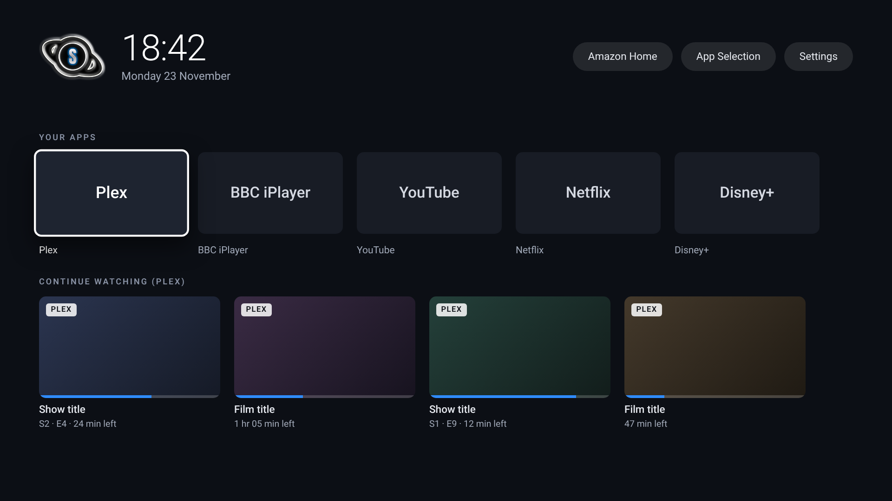

<p align="center">
  
</p>

<h1 align="center">SimpleLauncher</h1>
<p align="center"><b>by Cherry Universe</b></p>

SimpleLauncher is a clean, simple home screen for Amazon Fire TV and other Android devices.
It replaces the cluttered, advert-filled home screen with just what you need: your apps, the time,
and the shows you're part-way through.

- **Your apps, your way.** Choose which apps sit across the middle of the screen, and in what order.
- **Continue Watching (Plex).** Carry on where you left off, straight from the home screen.
- **No adverts, no tracking, no autoplay.** It's quiet, fast and lightweight.
- **Made to look good.** Smooth animations, and background and accent colours you choose.
- **Updates itself when you ask.** Settings › Information › Software update checks here for a newer build and installs it.
- **Works on Fire TV and other Android devices.** It detects which it's running on and sets itself up to suit.

## What it looks like

<p align="center">
  
</p>
<p align="center"><sub>The home screen on a Fire TV. On your TV, each app shows its own banner.</sub></p>

## Supported devices

Every device can use SimpleLauncher. Extras that change how the device behaves are only switched on
for devices that have been tested, so nothing can go wrong on the rest.

| Device | Model code | Tested on | SimpleLauncher | HomeCatch |
|---|---|---|:---:|:---:|
| Fire TV Stick HD | AFTSS | Fire OS 7 | ✓ | ✓ |
| Fire TV Stick 4K Max (2nd Gen) | AFTKRT | Fire OS 8 | ✓ | ✓ |
| Other Fire TV devices | | | ✓ (as an app) | Not yet |
| Google TV and Android TV (including TVs with their own home screen) | | | ✓ (as your home screen) | Being tested |
| Other Android devices, phones and tablets (Android 7.1+) | | | ✓ (as your home screen) | Not needed |

- **HomeCatch** makes the Home button on your remote open SimpleLauncher instead of Amazon's home
  screen on a Fire TV, or Google's on a Google TV (which ignores the home app setting). Other Android
  devices let you choose your home screen anyway, so they don't need it.

Want your device supported? [Open an issue](../../issues) with its name and model code. SimpleScript
shows the model code when it connects.

## How to install

### The easy way: SimpleScript (Windows, macOS and Linux)

SimpleScript walks you through everything: it gets the tools your computer needs, helps you switch on
ADB debugging on your TV, connects to it, and then installs SimpleLauncher (with HomeCatch on
supported Fire TVs).

**Windows**

1. Download **SimpleScript.ps1** from the [latest release](../../releases/latest).
   It's a plain PowerShell script, so you can open it in Notepad and read every line first.
2. Right-click it and choose **Run with PowerShell**, then follow the steps on screen.

   If Windows won't run it, open **PowerShell** and run:
   ```
   powershell -ExecutionPolicy Bypass -File "$HOME\Downloads\SimpleScript.ps1"
   ```

**macOS and Linux**

1. Download **SimpleScript.sh** from the [latest release](../../releases/latest).
2. Open **Terminal** and run:
   ```
   bash ~/Downloads/SimpleScript.sh
   ```
3. Follow the steps on screen.

You'll need your computer and TV on the same network. If ADB isn't installed, SimpleScript offers to
install it for you (with winget on Windows, Homebrew on a Mac, or by downloading it from Google) or
tells you how to do it yourself.

### Installing the app yourself

Download the APK from the [latest release](../../releases/latest) and install it however you
normally sideload apps (for example with Downloader on a Fire TV, or `adb install`).

This gives you SimpleLauncher as an app. On a Fire TV, HomeCatch needs a permission only a computer
can grant, so run SimpleScript once if you want the Home button to open SimpleLauncher.

On a Google TV you can switch HomeCatch on from the TV itself: in SimpleLauncher go to
Settings › Danger Zone › Switch on HomeCatch, and turn on "SimpleLauncher – HomeCatch". If that switch
is greyed out (newer Google TVs block it for apps installed outside the Play Store), open
SimpleLauncher's app info in the TV's settings, choose "Allow restricted settings" if it's there, and try again, or
use SimpleScript instead.

### Updating

Once installed, SimpleLauncher updates itself when you ask:
**Settings › Information › Software update**. Your apps and settings are kept.

---

<sub>SimpleLauncher is an independent project and isn't affiliated with Amazon or Plex.</sub>
